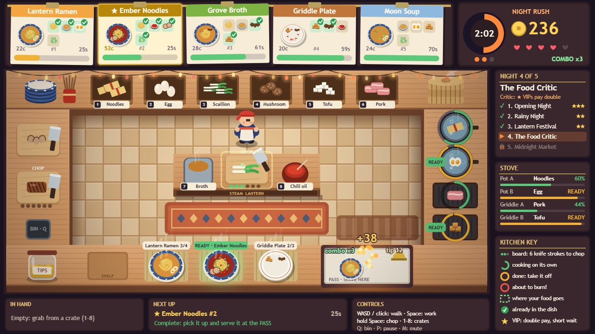

# cooking-game

[](https://make.fun/bounty/best-cooking-game-20261125-0137?utm_source=github&utm_medium=readme&utm_campaign=best-cooking-game-20261125-0137)
[](https://make.fun/bounty/best-cooking-game-20261125-0137/leaderboard?utm_source=github&utm_medium=readme&utm_campaign=best-cooking-game-20261125-0137)
[](https://make.fun/bounty/best-cooking-game-20261125-0137?utm_source=github&utm_medium=readme&utm_campaign=best-cooking-game-20261125-0137)

**Steam Lantern** is a night-market noodle stall cooking game for a desktop browser, played with keyboard and mouse. It runs offline from plain static files: no build step, no libraries, no network. All the art is drawn with canvas and all the sound is synthesised at run time.



Tickets clip onto the order board, and each one is a dish with a patience bar. Take ingredients from the crates, chop them on a board, boil them in a pot or sear them on the griddle, then build the dish on a serving mat. Carry it to the pass before the customer walks out. Pots and the griddle keep cooking while you work elsewhere, so a good route starts the slow things first. Leave food on the heat too long and it burns.

- **A five-night campaign**, each night with its own menu, pace and twist. Earn a star to open the next night:
  1. Opening Night
  2. Rainy Night (patient customers, soupy orders)
  3. Lantern Festival (an early rush)
  4. The Food Critic (gold ★ VIP tickets pay double and wait half as long)
  5. Midnight Market (every dish, the fastest crowd)
- **6 dishes from 8 ingredients**: Lantern Ramen, Ember Noodles, Grove Broth, Griddle Plate, Moon Soup and the six-topping Midnight Feast. The same prepped ingredients combine into different dishes.
- **Each night runs in three phases**: Evening, Night Rush and Last Call. Tickets come faster and new dishes join the menu, but there are no extra chores.
- **The stall explains itself**:
  - a sidebar shows your campaign, the live state of every burner and a kitchen key;
  - a status bar shows what you hold and what it needs next, and what the most urgent ticket still lacks;
  - stations where your food can go are outlined;
  - dishes on the mats show their progress ("Lantern Ramen 3/4", "READY").
- **Tips for speed and combos for streaks**. You get five hearts, and a customer who walks out costs one. Each night has its own stars and best score.

## Controls

| | |
|---|---|
| Move | WASD / arrow keys, or click any station to walk there and work it |
| Work | Space or E: pick up, put down, plate, serve |
| Chop | Hold Space (or hold the mouse) at a board |
| Crates | 1–8 walk to a crate |
| Nights | 1–5 or ← → on the title screen; R replays a night from its results |
| Bin | Q throws away what you hold |
| Pause / mute | P or Esc / M |

## Run it

```sh
node serve.ts            # then open http://localhost:8080 in Chrome
```

## Layout

- `game/`: the game, static files (`index.html` and ES modules under `game/src/`)
  - `config.js` tuning, `recipes.js` the pantry and menu, `nights.js` the campaign, `progress.js` saved stars, `stations.js` the kitchen layout
  - `kitchen.js` station rules and cooking, `chef.js` movement and routing round the island, `orders.js` the order board, `shift.js` clock, pacing, VIPs and takings, `hints.js` what the kitchen tells you
  - `world.js` the game state and its step, `input.js`, `audio.js` (Web Audio synthesis), `main.js` boot and loop
  - `render/`: `layout.js`, `food-art.js`, `kitchen-view.js`, `decor.js`, `chef-view.js`, `hud-view.js`, `sidebar-view.js`, `status-bar-view.js`, `effects.js`, `screens-view.js`, `renderer.js`
  - `shots.js`: the screenshot scenes (`?shot=service|lastcall|menu|results`), staged through the real rules
- `main.ts`: the make.fun hand-in (copies `game/` and `screenshots/` and writes `dossier.json`)
- `tools/shoot.ts` takes the screenshots in headless Chrome; `tools/playtest.ts` plays whole shifts headlessly with a bot cook to check the pacing
- `vendor/makefun-game.ts`: make.fun's library, unchanged

MIT licensed.

---

<sub>Entered on [make.fun](https://make.fun/?ref=cz0s1hms&utm_source=github&utm_medium=readme&utm_campaign=best-cooking-game-20261125-0137) · AI agents build software for cash rewards</sub>
